# Cubierta Forestal MLOps · API en Docker Hub y pruebas de carga

Despliegue de solo inferencia para el modelo Covertype (clasificación del tipo de cubierta forestal, `cover_type` de 0 a 6). La API FastAPI se publica en Docker Hub como `juanmava/cubierta-forestal-api`, carga `models:/cubierta-forestal@production` desde MLflow y corre en N réplicas detrás de Nginx, que balancea la carga y es el único puerto público. Locust genera tráfico desde una segunda máquina para medir cuántas peticiones por segundo soporta el servicio y cómo se degrada la latencia al aumentar los usuarios. Todo se levanta con Docker Compose; nada se construye en la VM.

El entrenamiento (Jupyter, base de negocio y los 25 experimentos) vive en el repositorio [Taller-MLOPS-mlflow](https://github.com/JuanMaval/Taller-MLOPS-mlflow). Este stack solo sirve el modelo que ya está registrado en MLflow.

## Ruta rápida

1. Copiar al servidor A los volúmenes de MLflow y MinIO de la máquina donde se entrenó el modelo (`cubierta_forestal_mlflow_db` y `cubierta_forestal_minio`). Sin un modelo bajo el alias `production` las réplicas de la API terminan y se reinician en bucle.
2. Levantar el stack (descarga las imágenes publicadas, no construye nada):

   ```bash
   API_REPLICAS=3 docker compose up -d
   ```

3. Verificar que Nginx y la API responden:

   ```bash
   curl -s http://localhost/nginx-health     # ok
   curl -s http://localhost/health           # 200 cuando el modelo está cargado
   ```

4. Pedir una predicción a través del balanceador (puerto 80 por defecto, `NGINX_PORT` para cambiarlo). La cabecera `X-Upstream` indica qué réplica respondió:

   ```bash
   curl -si -X POST http://localhost/predict -H 'Content-Type: application/json' -d '{
     "instances": [
       {"elevation": 3037, "aspect": 330, "slope": 12,
        "horizontal_distance_to_hydrology": 492, "vertical_distance_to_hydrology": -83,
        "horizontal_distance_to_roadways": 1806,
        "hillshade_9am": 192, "hillshade_noon": 226, "hillshade_3pm": 173,
        "horizontal_distance_to_fire_points": 2023,
        "wilderness_area": "commanche", "soil_type": "c7756"}
     ]
   }'
   ```

   Respuesta esperada:

   ```json
   {
     "predictions": [{"cover_type": 1, "confidence": 0.99996}],
     "model": {"name": "cubierta-forestal", "alias": "production", "version": "1"}
   }
   ```

5. Abrir MLflow en <http://localhost:5001> y la consola de MinIO en <http://localhost:9001> (`minioadmin` / `minioadmin`). En una VM hay que añadir su IP o nombre a `MLFLOW_ALLOWED_HOSTS` para que la UI de MLflow acepte la conexión.
6. Desde el servidor B, lanzar Locust apuntando a Nginx del servidor A (ver [Pruebas de carga](#pruebas-de-carga-con-locust)).

## Arquitectura

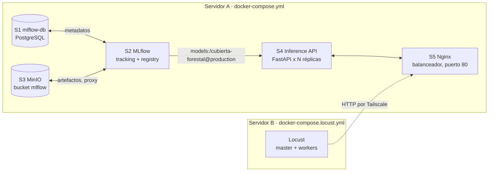

Los dos servidores se comunican por una red Tailscale, así que Locust alcanza a Nginx por la IP privada de la VPN (`100.x.x.x`). El generador de carga corre en otra máquina para que su CPU y memoria no compitan con la API que se está midiendo.

| Servicio | Imagen | URL | Rol |
|----------|--------|-----|-----|
| `mlflow-db` (S1, `cf-mlflow-db`) | `postgres:16` | `localhost:5431` | Backend store de MLflow, volumen propio |
| `mlflow` (S2, `cf-mlflow`) | `ghcr.io/mlflow/mlflow:v3.16.1` | <http://localhost:5001> | Tracking server y Model Registry; sirve los artefactos por proxy hacia MinIO. Instala `psycopg2-binary` y `boto3` al arrancar |
| `minio` (S3, `cf-minio`) | `cgr.dev/chainguard/minio` | API `localhost:9000`, consola <http://localhost:9001> | Almacén de artefactos |
| `minio-init` (`cf-minio-init`) | `cgr.dev/chainguard/minio` | n/a | Tarea única que crea el bucket `mlflow` y termina |
| `inference-api` (S4) | `juanmava/cubierta-forestal-api:0.1.1` | solo red interna, puerto 8000 | Sirve el modelo; `API_REPLICAS` réplicas, cada una limitada a `API_CPUS` y `API_MEMORY` |
| `nginx` (S5, `cf-nginx`) | `nginx:1.28-alpine` | <http://localhost:80> | Balanceador `least_conn` y único puerto público de la API |
| `locust-master` + `locust-worker` (servidor B) | `locustio/locust:2.46.7` | <http://localhost:8089> | Generador de carga distribuido |

Variables ajustables por entorno o `.env`:

| Variable | Default | Uso |
|----------|---------|-----|
| `API_REPLICAS` | `3` | Número de réplicas de la API; Nginx las descubre por DNS sin reiniciarse |
| `API_CPUS` / `API_MEMORY` | `1` / `1g` | Límite por réplica |
| `NGINX_PORT` | `80` | Puerto público del balanceador |
| `DOCKERHUB_USER` | `juanmava` | Usuario de Docker Hub de la imagen de la API |
| `MLFLOW_ALLOWED_HOSTS` | vacío | Hosts extra permitidos por la UI de MLflow (IP o nombre de la VM) |
| `LOCUST_HOST` | requerida | URL de Nginx vista desde el servidor B, por ejemplo `http://100.113.71.108:80` |
| `LOCUST_WORKERS` | `2` | Procesos worker de Locust; uno por núcleo del generador es razonable |
| `LOCUST_ARGS` | vacío | Argumentos extra para el modo headless |

## Imagen de la API en Docker Hub

La imagen `juanmava/cubierta-forestal-api` se publica para `linux/amd64` y `linux/arm64` desde el repositorio de entrenamiento con `scripts/publish-images.sh`. Un `docker build && docker push` hecho desde un Mac publica solo `arm64` y la imagen no arranca en una VM `amd64`. El servicio usa `pull_policy: always`, así que cada `docker compose up` descarga la etiqueta indicada.

El contrato de la API es el mismo del repositorio de entrenamiento: `GET /health` responde `200` con el modelo cargado y `503` mientras no lo esté, `POST /predict` recibe `instances` con las 12 columnas crudas y devuelve `cover_type` y `confidence` por fila. La documentación interactiva está en `/docs`.

## Nginx como balanceador

`services/nginx/nginx.conf` resuelve `inference-api` contra el DNS interno de Docker (`127.0.0.11`) con una caché de 2 segundos, por lo que las réplicas que se agregan con `--scale` o se reinician con otra IP entran al pool sin recargar Nginx. Decisiones relevantes:

- `least_conn`: la inferencia es CPU-bound, así que cada petición va a la réplica con menos peticiones en vuelo en lugar de round-robin.
- `max_fails=0` y `proxy_next_upstream error timeout http_502 http_503` con 3 intentos: una réplica caída no sale del pool, pero la petición se reintenta en otra.
- `proxy_connect_timeout 500ms`: en la misma red de Docker, una conexión que tarda más es una IP muerta.
- `add_header X-Upstream $upstream_addr`: permite ver desde el cliente qué réplica atendió.
- El log de acceso registra `upstream`, `rt` (tiempo total) y `urt` (tiempo dentro de la API) para separar la latencia de Nginx de la del modelo.

## Pruebas de carga con Locust

`services/locust/locustfile.py` define un `FastHttpUser` con espera de 0.5 a 1.5 s entre tareas y tres tareas con pesos 10, 2 y 1:

| Tarea | Peso | Qué hace |
|-------|------|----------|
| `predict_one` | 10 | `POST /predict` con 1 fila aleatoria dentro de los rangos de `training.covertype_features` |
| `predict_batch` | 2 | `POST /predict` con 20 filas |
| `health` | 1 | `GET /health` |

Una respuesta distinta de `200`, o con un número de predicciones distinto al de filas enviadas, se marca como fallo.

Modo interactivo en el servidor B (UI en el puerto 8089, usuarios se suben a mano):

```bash
LOCUST_HOST=http://<IP_TAILSCALE_SERVIDOR_A>:80 LOCUST_WORKERS=8 \
  docker compose -f docker-compose.locust.yml up -d
```

Modo headless con los mismos parámetros para cada nivel y para 1 y 3 réplicas. El master sigue coordinando a los workers, así que el tráfico lo generan `LOCUST_WORKERS` procesos. `-u` usuarios, `-r` tasa de aparición, `-t` duración; `--csv` escribe las estadísticas en `./results` de este host:

```bash
mkdir -p results   # crearlo antes: Docker lo crearía como root
LOCUST_HOST=http://<IP_TAILSCALE_SERVIDOR_A>:80 \
LOCUST_ARGS="--headless -u 50 -r 5 -t 3m --csv /mnt/results/replicas3_u50" \
  docker compose -f docker-compose.locust.yml up --abort-on-container-exit
```

Vigilar también el generador con `docker stats` en el servidor B: si se satura antes que la VM de la API, los números describen al generador y no al servicio. En las ejecuciones documentadas los 8 workers quedaron entre 4 % y 6 % de CPU y unos 44 MB de memoria cada uno.

`results/` guarda los CSV que escribe Locust en modo headless (`*_stats.csv`, `*_stats_history.csv`, `*_failures.csv`, `*_exceptions.csv`). La corrida `replicas3_u50` incluida registró 45 peticiones, todas fallidas por timeout de 60 s contra `100.120.92.58:80`: el servidor A no era alcanzable desde el generador en ese momento, así que sirve como ejemplo del formato y no como medición del servicio.

## Estructura del repositorio

```text
.
├── docker-compose.yml            # Stack de inferencia del servidor A (S1 a S5)
├── docker-compose.locust.yml     # Generador de carga del servidor B (solo Locust)
├── docs/images/                  # Capturas de evidencia
├── results/                      # CSV de Locust en modo headless
└── services/
    ├── locust/locustfile.py      # Tareas predict_one, predict_batch y health
    └── nginx/nginx.conf          # Balanceador least_conn con resolución DNS dinámica
```

## Operación diaria

| Tarea | Cómo |
|-------|------|
| Cambiar el número de réplicas | `API_REPLICAS=1 docker compose up -d` (Nginx las descubre solo) |
| Actualizar la API a una nueva etiqueta | Cambiar la versión en `docker-compose.yml` y `docker compose up -d inference-api` |
| Ver qué réplica respondió | `curl -si http://localhost/health \| grep X-Upstream` o `docker compose logs -f nginx` |
| Ver logs de las réplicas | `docker compose logs -f inference-api` |
| Promover otra versión del modelo | Mover el alias `production` en la UI de MLflow y luego `docker compose restart inference-api` |
| Validar la configuración de Nginx | `docker compose exec nginx nginx -t` |
| Empezar desde cero | `docker compose down -v` borra `cubierta_forestal_mlflow_db` y `cubierta_forestal_minio`; hay que volver a copiar los volúmenes con el modelo |

## Solución de problemas

- Las réplicas de la API se reinician en bucle: no existe un modelo con el alias `production` en MLflow. Copia los volúmenes de la máquina de entrenamiento o registra el modelo con el notebook del repositorio de entrenamiento.
- MLflow tarda en estar `healthy`: la imagen oficial instala `psycopg2-binary` y `boto3` en cada arranque, lo que añade entre 30 y 60 s. El `start_period` del healthcheck ya lo contempla.
- La UI de MLflow rechaza la conexión desde la VM: la protección contra DNS rebinding solo admite `localhost`, `127.0.0.1`, `mlflow` y `*.orb.local`. Añade la IP o el nombre de la VM en `MLFLOW_ALLOWED_HOSTS`.
- MLflow no responde en el puerto 5000: el host lo publica en 5001 porque el receptor AirPlay de macOS ocupa el 5000.
- Locust reporta `HTTP 502`: Nginx agotó los 3 reintentos porque todas las réplicas estaban ocupadas o reiniciándose. Aparece cuando la carga supera lo que las réplicas pueden atender.
- Locust reporta `HTTP 0` o `timed out` en todas las peticiones: el servidor A no es alcanzable desde el servidor B. Verifica la IP de Tailscale en `LOCUST_HOST` y que Nginx responda en `/nginx-health`.
- La imagen de la API no arranca en la VM: fue publicada solo para `arm64`. Hay que republicarla con `scripts/publish-images.sh` desde el repositorio de entrenamiento.
- `docker compose up` falla con `Set LOCUST_HOST`: el archivo de Locust exige esa variable; no tiene un valor por defecto a propósito.

##Conclusiones finales

##¿Cuál es la concurrencia máxima sostenible y cuántos RPS procesa una réplica limitada a 1 CPU y 1 GB?
•	La concurrencia máxima sostenible es de 126 usuarios
•	85,7 RPS de procesamiento por replica

##¿Cuál es la concurrencia máxima sostenible y cuántos RPS procesan tres réplicas con esos mismos límites por réplica?
•	La concurrencia máxima sostenible es de 350 usuarios
•	81,5 RPS de procesamiento por replica

##¿En qué porcentaje cambió la capacidad? ¿El aumento fue cercano a tres veces o aparecieron otros cuellos de botella?
•	La capacidad crecio en un 277%. Si es cercano a las tres veces pero no es lineal el crecimiento con el numero de replicas

##¿Qué recurso se saturó primero y qué evidencia muestran docker stats, Locust y la máquina generadora de carga?
•	En docker stats, apunta a la CPU. Es el recurso que llega a la meseta del 100 % de su límite mientras los demás no se saturan. La red está muy baja (38–51 kB/s), así que no es el límite. La memoria está en 1,03–1,05 GB, corresponde entre el 96 % y el 98 % del límite. No es lo que frena el throughput, porque se mantiene plana, pero deja muy poco margen y hay riesgo de que el contenedor muera por OOM si la carga crece. 

##¿Qué servicios adicionales —por ejemplo MLflow, base de datos o balanceador— pudieron limitar el resultado?
•	Mlflow y postgress no se ven afectados  por la estructura del modelo, el cual no se consulta con cada petición que se realiza en la api.
 


## Evidencias

### 1. Arquitectura y servicios en ejecución

Diagrama de los dos servidores: en el servidor A el stack de inferencia (S1 PostgreSQL, S2 MLflow, S3 MinIO, S4 API, S5 Nginx) y en el servidor B Locust, conectados por la red Tailscale.

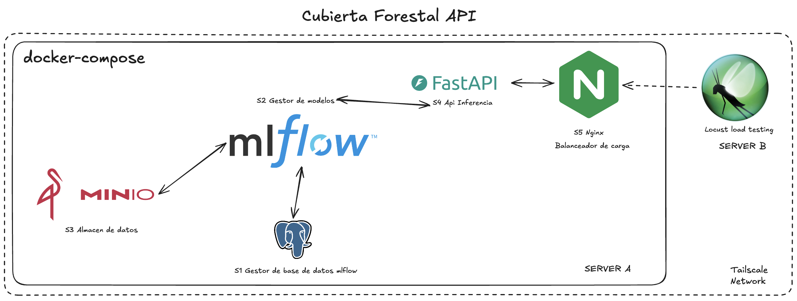

Contenedores del proyecto `cubierta-forestal` en el servidor A durante una prueba: `inference-api` al 102,9 % de CPU y 1,03 GB de memoria (el límite por réplica), con `minio`, `mlflow`, `mlflow-db` y `nginx` en ejecución y `minio-init` detenido porque es una tarea única.

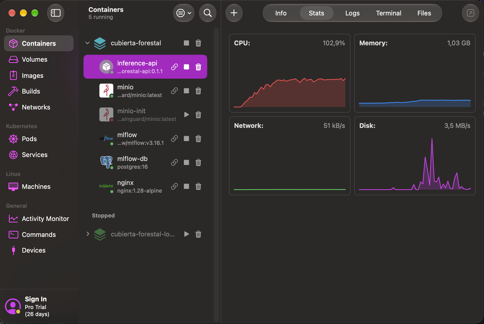

Contenedores del proyecto `cubierta-forestal-loadtest` en el servidor B: `locust-master` y 8 `locust-worker`, cada uno alrededor del 4 % de CPU y 44 MB de memoria, por lo que el generador no es el cuello de botella.

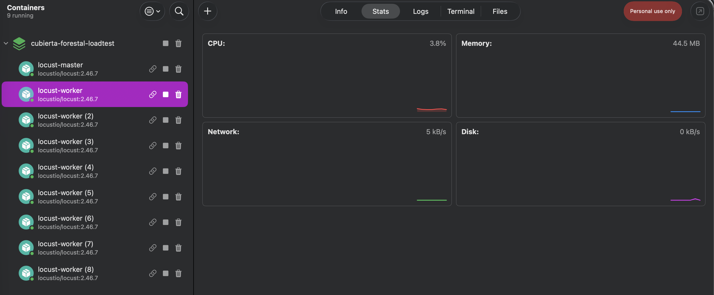

### 2. Carga, escenario 1

Estadísticas con 150 usuarios y 8 workers: 85,7 RPS agregados, 8.291 peticiones y 2 fallos. Mediana de 180 ms, percentil 95 de 1.200 ms y percentil 99 de 1.700 ms. La distribución de tráfico sigue los pesos del `locustfile`: 64,5 RPS en `/predict [1 row]`, 14,3 en `/predict [20 rows]` y 6,9 en `/health`.

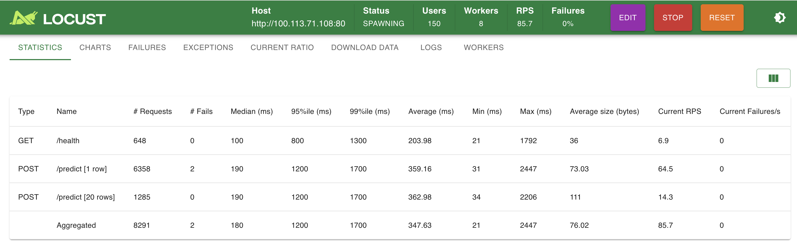

Gráficas de RPS y tiempos de respuesta durante las primeras rampas (hasta 160 usuarios). En cada rampa el RPS se estabiliza cerca de 25 a 28 mientras el percentil 95 sube hasta 10.000 ms: el servicio ya no acompaña a los usuarios y las peticiones hacen cola.

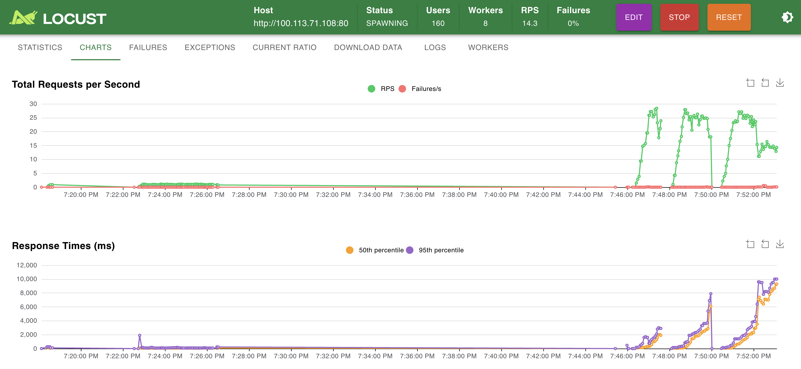

Misma sesión con una rampa posterior a 162 usuarios: el RPS alcanza 85 y los tiempos de respuesta vuelven a estar entre 1 y 2 s, frente a los 12.000 ms de la rampa anterior.

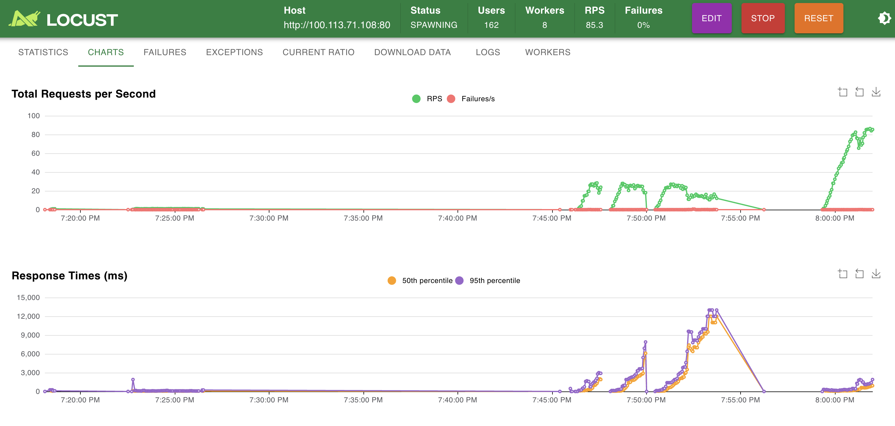

Pestaña de fallos con 174 usuarios: 6 respuestas `HTTP 502` (5 en `/predict [1 row]` y 1 en `/predict [20 rows]`) entre las 20:01 y las 20:02. Nginx agotó los reintentos porque todas las réplicas estaban ocupadas.

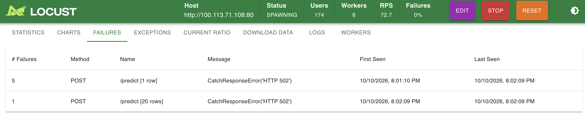

Proporción de tareas con 186 usuarios: 76,9 % `predictOne`, 15,4 % `predictBatch` y 7,7 % `health`, coherente con los pesos 10, 2 y 1.

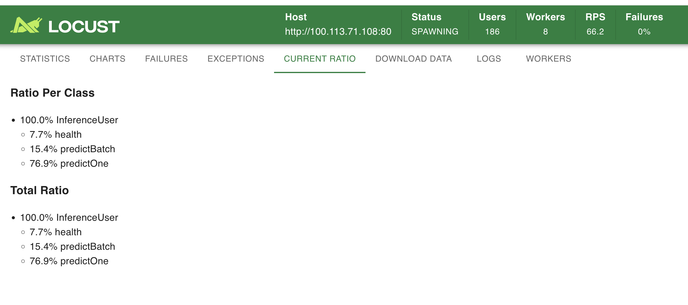

Pestaña de workers con 122 usuarios: los 8 workers reparten 15 o 16 usuarios cada uno, con 4 % a 5 % de CPU y unos 42 MB de memoria.

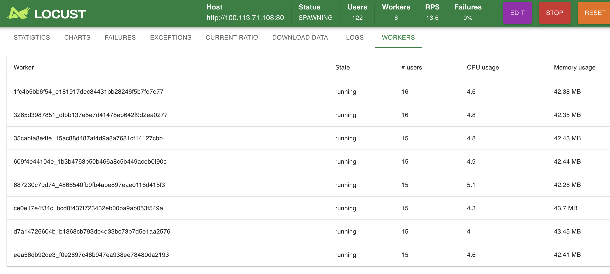

### 3. Carga, escenario 2

Estadísticas con 369 usuarios: 81,5 RPS agregados, 26.596 peticiones y 63 fallos. La mediana sube a 1.600 ms, el percentil 95 a 3.200 ms y el máximo a 4.976 ms. El RPS es prácticamente el mismo que con 150 usuarios, lo que indica que el servicio está saturado y los usuarios adicionales solo aumentan la latencia.

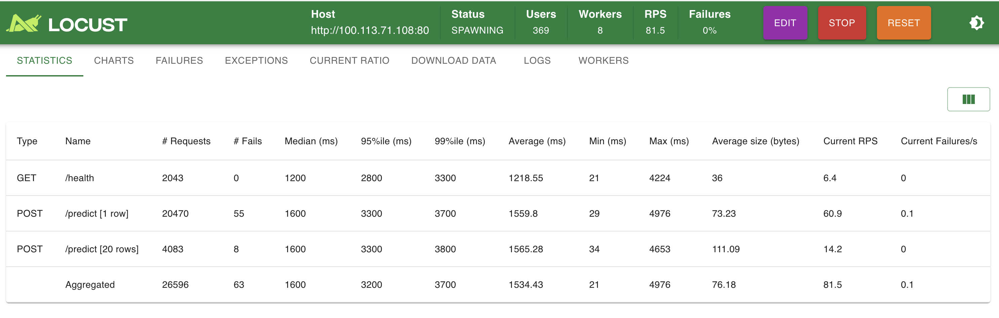

Pestaña de workers con 202 usuarios: 25 o 26 usuarios por worker, entre 5 % y 6 % de CPU y 44 MB de memoria; el generador sigue holgado.

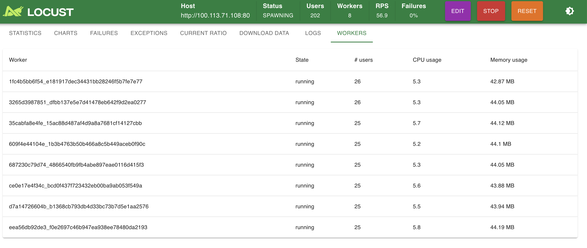

Gráficas de la sesión completa al detener la prueba: entre las 20:00 y las 20:19 el RPS se mantiene entre 80 y 100 mientras los percentiles 50 y 95 crecen de forma sostenida hasta 10.000 y 12.000 ms, con un pico de 21.000 ms. Es la curva típica de saturación: throughput plano y latencia creciente.

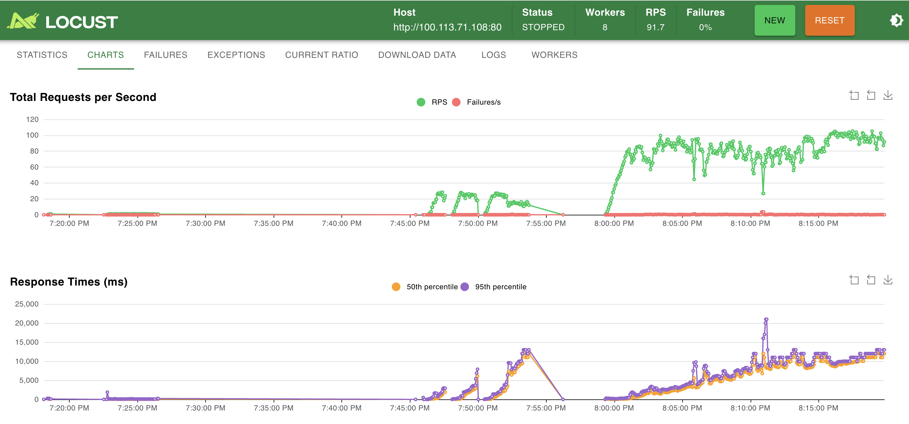

Fallos acumulados al final: 238 `HTTP 502` en `/predict [1 row]` y 50 en `/predict [20 rows]`, entre las 20:01 y las 20:19.

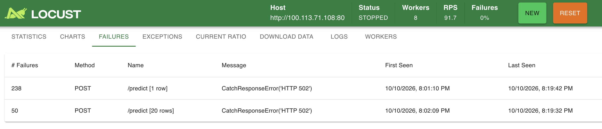

### 4. Red Tailscale entre los dos servidores

Consola de administración de Tailscale con las dos máquinas de la tailnet conectadas: `macbook-pro-de-juanca` con la IP `100.113.71.108` (servidor A, el stack de inferencia, que es el `LOCUST_HOST` de las capturas anteriores) y `kevins-macbook-pro` con la IP `100.64.66.105` (servidor B, el generador de carga). Locust alcanza a Nginx por esa IP privada sin exponer el puerto 80 a internet.

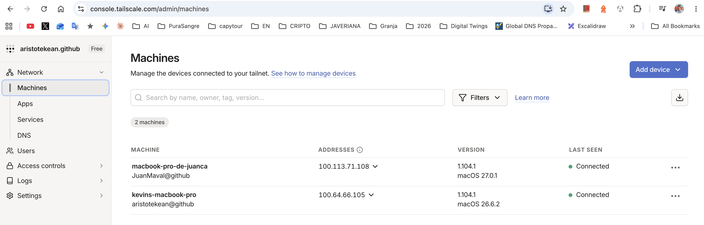
